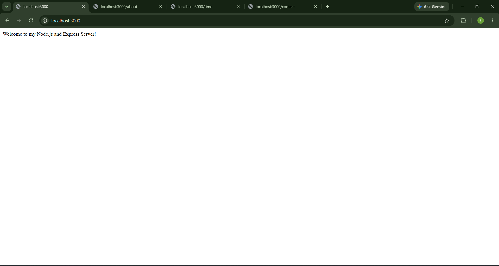
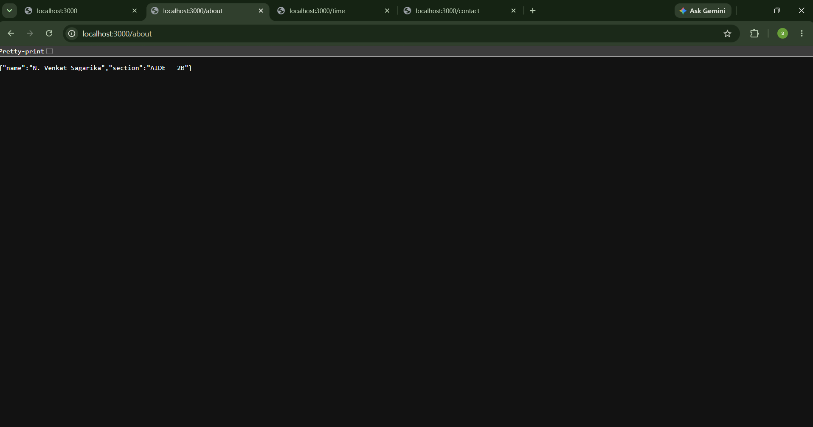
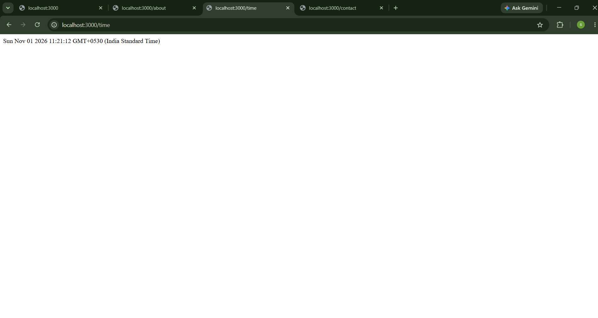
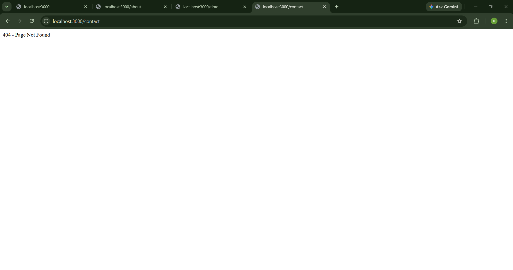

# Lab 1: Node.js and Express Server

## Student Details

- **Name:** N. Venkat Sagarika
- **Registration Number:** 252U1R5115
- **Section:** AIDE - 2B

## Live Deployment

https://bdf-lab-01-zszv.onrender.com

## Lab Objective

To create a Node.js server using Express.js, implement different GET routes, handle invalid routes using a 404 response, and log HTTP request methods, URLs, and status codes.

## Installation and Execution

### Prerequisites

- Node.js installed
- Visual Studio Code
- Basic knowledge of JavaScript

### Installation

1. Open the project folder in VS Code.
2. Open the terminal.
3. Install the required dependencies:

```bash
npm install
```

### Run the Server

Execute the following command:

```bash
node index.js
```

The server will start locally at:

http://localhost:3000

### Environment Variables

The server uses `process.env.PORT` with port `3000` as the default value. No additional environment variables are required.

## API Endpoints

| HTTP Method | Endpoint | Description | Status Code |
|---|---|---|---|
| GET | `/` | Displays the welcome message | 200 |
| GET | `/about` | Returns student details in JSON format | 200 |
| GET | `/time` | Displays the current date and time | 200 |
| GET | `/contact` | Handles unknown routes | 404 |

## Problems Faced and Solutions

1. **Port Configuration:** Configured the Express server to use the deployment platform's port, with 3000 as the local default.
2. **Route Testing:** Tested different GET endpoints using the browser.
3. **404 Error Handling:** Implemented middleware to return a 404 response for undefined routes.
4. **Request Logging:** Added middleware to log HTTP methods, URLs, and response status codes.

## Notes

All required routes were tested successfully using the browser and the deployed Render URL. The server returned the expected responses and status codes.

## Screenshots

### 1. Home Page (GET /)



### 2. About Page (GET /about)



### 3. Current Date and Time (GET /time)



### 4. Invalid Route (404 Error)

