# Lab 4: User Registration, Login and JWT Authentication

## Student Details

| Particulars | Details | Particulars | Details |
|---|---|---|---|
| Student Name | N. VENKAT SAGARIKA | Roll Number | 252U1R5115 |
| Section | AIDE-2B | Term | Term - II |
| Subject | Backend Development Fundamentals | Module Number | 4 |
| Module Title | Authentications and User Management | Submission Date | 14-11-2026 |

## Live Deployment

**Live Application URL:**  
https://bdf-lab-04-auth-api.onrender.com

**Available API Endpoints:**

| Functionality | Method | Endpoint |
|---|---|---|
| User Registration | POST | `/register/` |
| User Login | POST | `/login/` |

Live Server Status: Successfully deployed on Render and tested using Postman.

## Objective

To implement user registration and login functionality using Node.js, Express.js and SQLite. Passwords are securely stored using bcrypt hashing, and JSON Web Tokens (JWT) are generated to authenticate users after successful login.

## Technologies Used

- Node.js
- Express.js
- SQLite
- bcrypt
- jsonwebtoken
- Postman
- Visual Studio Code
- Render

## Project Structure

```text
lab-04/
│
├── index.js
├── bookstore.db
├── package.json
├── package-lock.json
├── README.md
└── screenshotsL4/
    ├── database_password_hash.png
    ├── jwt_decoded.png
    ├── live_login_success.png
    ├── login_missing_fields.png
    ├── login_success.png
    ├── login_unknown_user.png
    ├── login_wrong_password.png
    ├── register_duplicate.png
    ├── register_missing_fields.png
    ├── register_success.png
    ├── register_success_live.png
    └── users_table.png
```

## Installation and Execution

1. Navigate to the Lab 4 directory.

```bash
cd lab-04
```

2. Install the required dependencies.

```bash
npm install
```

3. Start the server.

```bash
npm start
```

4. The local server runs at:

```text
http://localhost:3002/
```

## Database Structure

A SQLite database named `bookstore.db` is used to store user information.

The `users` table contains the following columns:

| Column | Description |
|---|---|
| id | Unique user ID |
| username | Unique username |
| name | User's full name |
| password | Bcrypt-hashed password |

Passwords are stored as bcrypt hashes instead of plain text.

## API Endpoints

### 1. User Registration

**Endpoint:** `POST /register/`

Registers a new user by accepting a username, name and password. The password is hashed using bcrypt before being stored in the database.

**Request Body:**

```json
{
  "username": "sagarika",
  "name": "Sagarika",
  "password": "YourPassword"
}
```

**Expected Responses:**

- `201 Created` – User registered successfully.
- `400 Bad Request` – Username already exists or required fields are missing.

### 2. User Login

**Endpoint:** `POST /login/`

Authenticates an existing user by checking the submitted password against the stored bcrypt hash. If authentication is successful, a JWT token is generated using `jsonwebtoken`.

**Request Body:**

```json
{
  "username": "sagarika",
  "password": "YourPassword"
}
```

**Expected Responses:**

- `200 OK` – Login successful and JWT token generated.
- `400 Bad Request` – Invalid username, incorrect password or missing fields.

## Testing and Results

The APIs were tested using Postman with valid and invalid inputs.

The following test cases were verified:

| Test Case | Expected Result |
|---|---|
| Successful registration | 201 Created |
| Duplicate username | 400 Bad Request |
| Missing registration fields | 400 Bad Request |
| Successful login | 200 OK with JWT token |
| Incorrect password | 400 Bad Request |
| Unknown username | 400 Bad Request |
| Missing login fields | 400 Bad Request |
| Live registration | Successful |
| Live login | 200 OK with JWT token |

## Screenshots

### 1. Database and Password Hashing

**Database Password Hash**

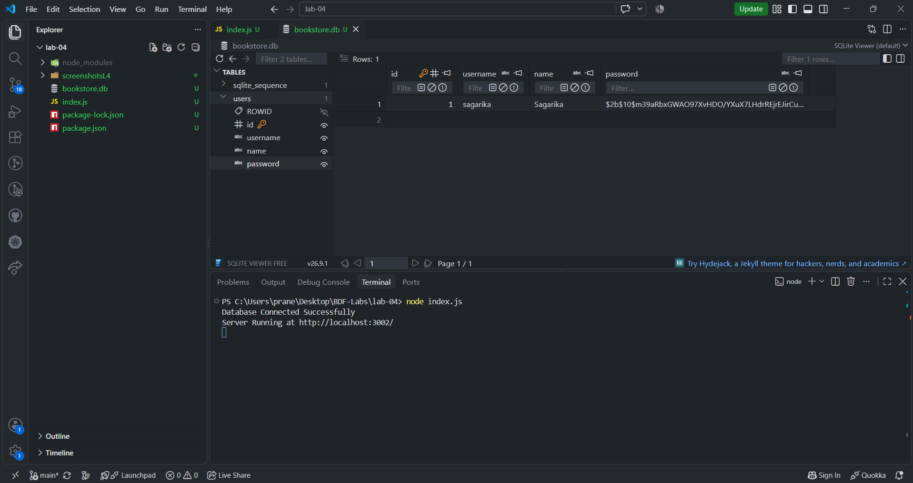

**Users Table**

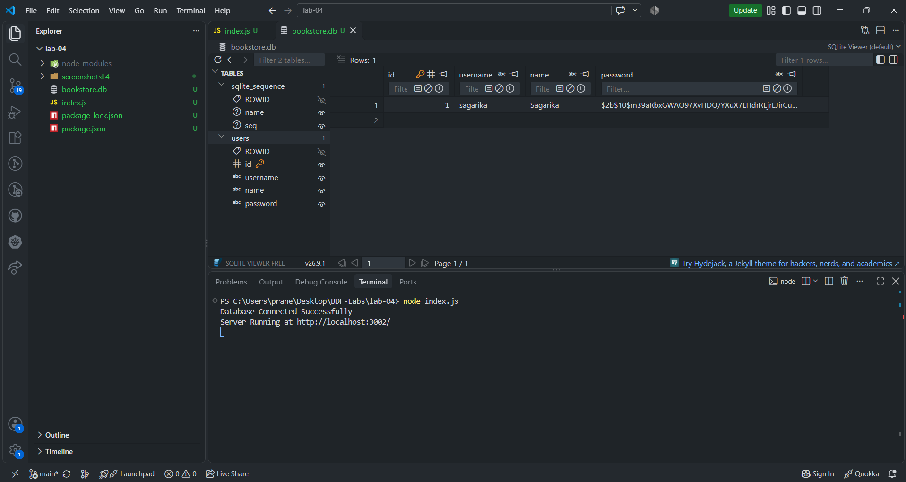

### 2. User Registration Testing

**Successful Registration**

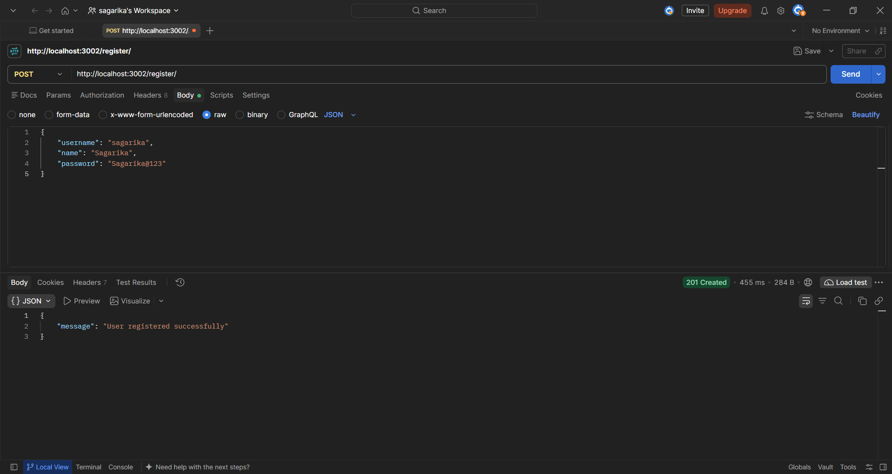

**Duplicate Username**

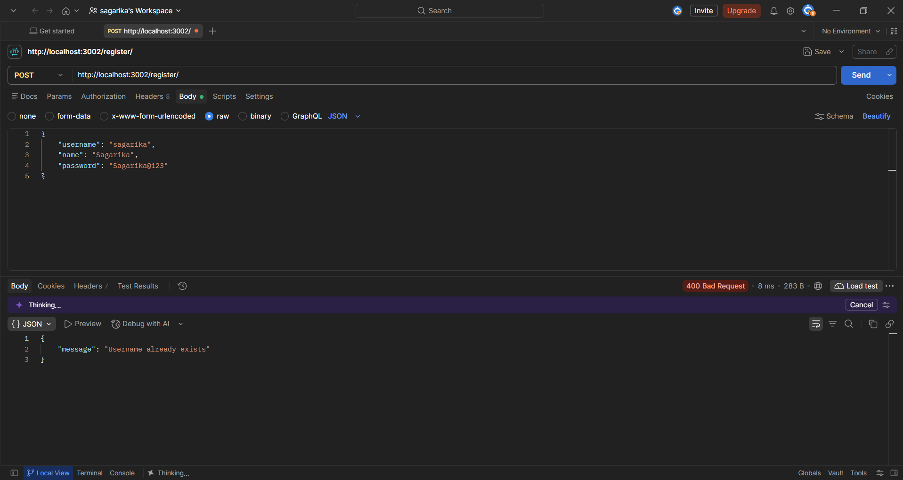

**Missing Registration Fields**

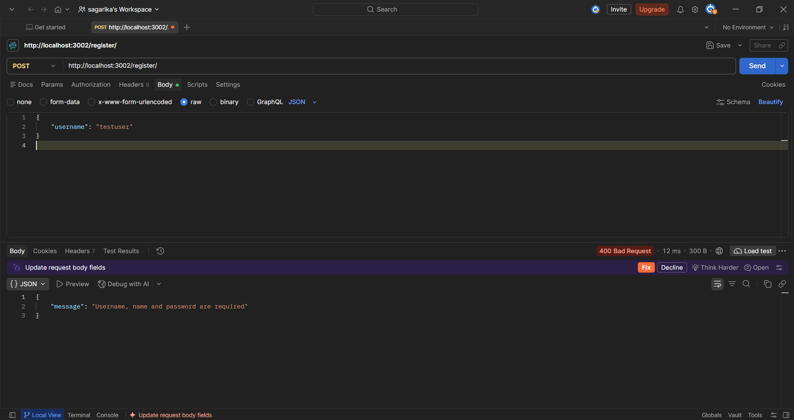

**Successful Live Registration**

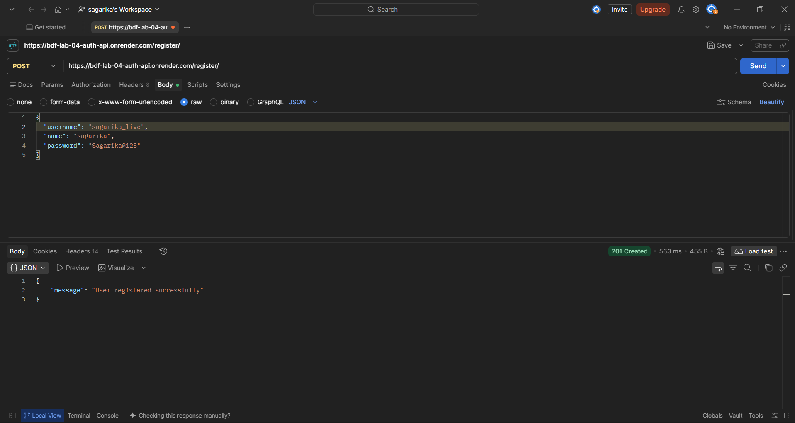

### 3. User Login Testing

**Successful Login**

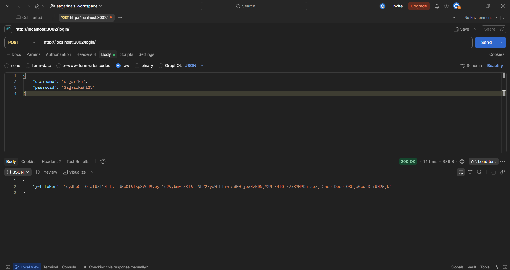

**Incorrect Password**

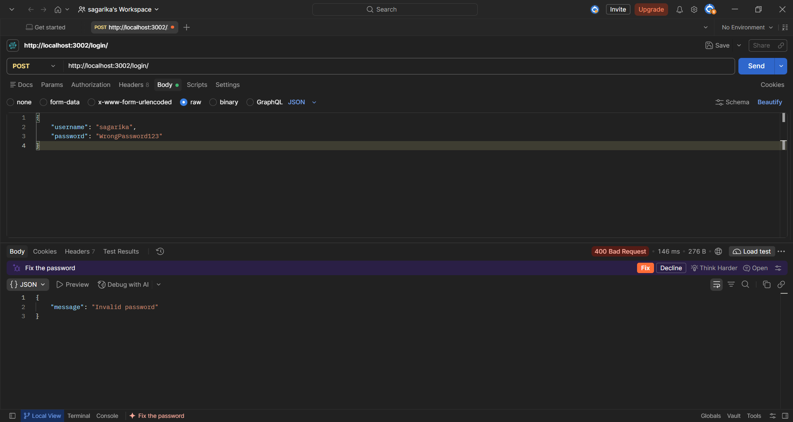

**Unknown Username**

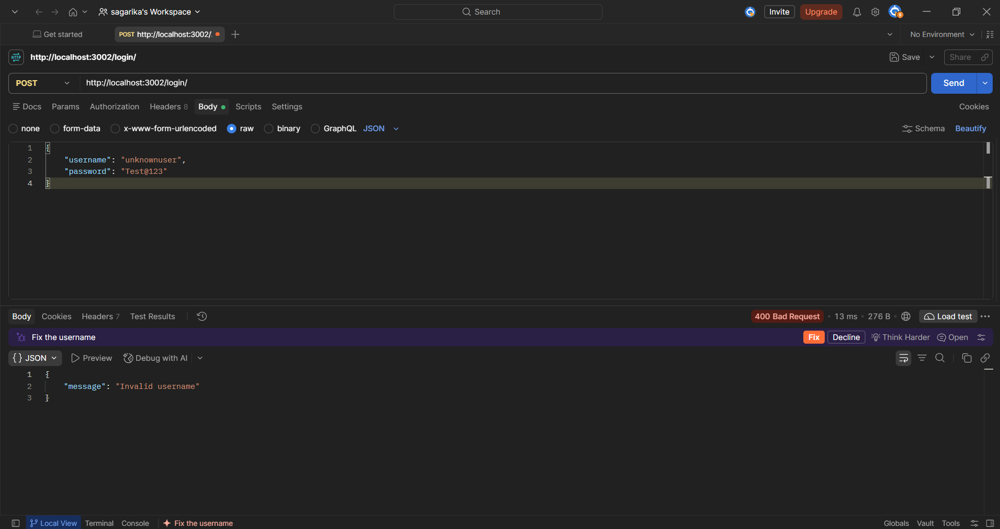

**Missing Login Fields**

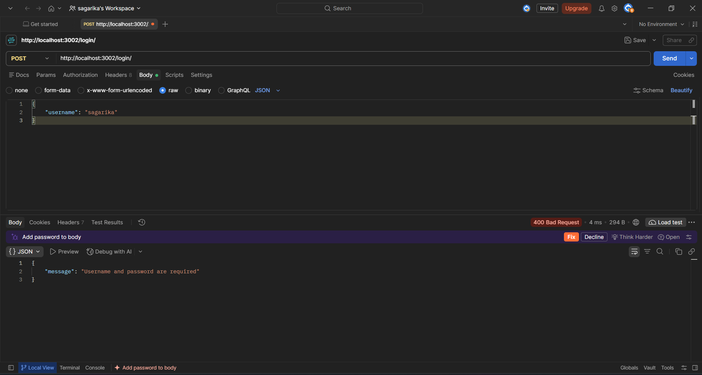

**Successful Live Login**

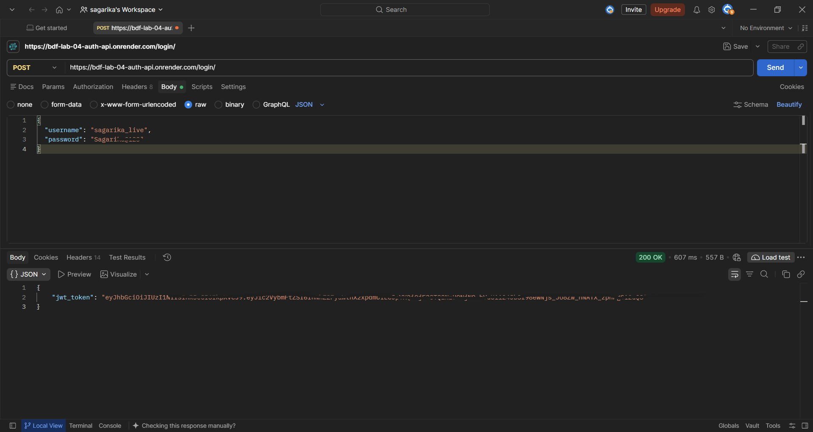

### 4. JWT Authentication

**Decoded JWT Token**

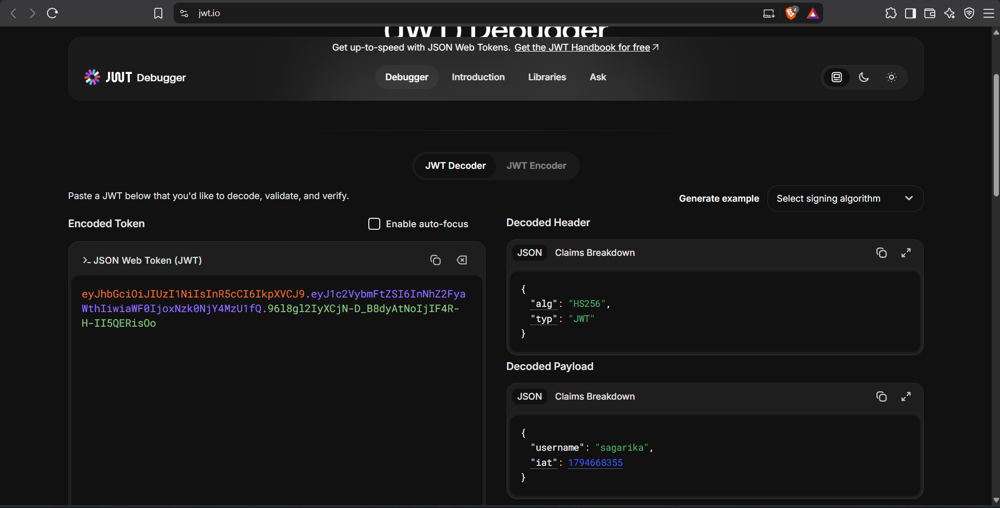

The JWT token was decoded to examine its header, payload and signature. The payload contains the username and does not contain the user's password.

## Conclusion

In this lab, user registration and login functionality were successfully implemented using Node.js, Express.js and SQLite. Passwords were securely hashed using bcrypt before being stored in the database. The login functionality verifies user credentials and generates JWT tokens for successful authentication. Both successful and unsuccessful scenarios were tested using Postman, and the application was successfully deployed on Render. This lab provided practical experience in backend API development, database integration, password security and JWT-based authentication.